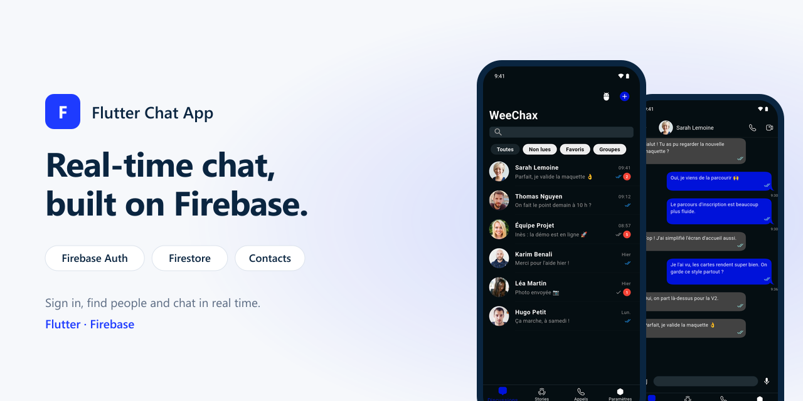
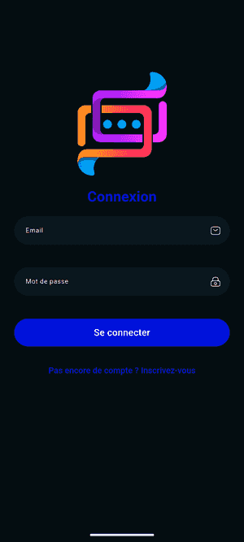
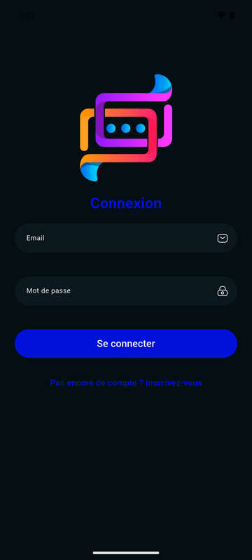
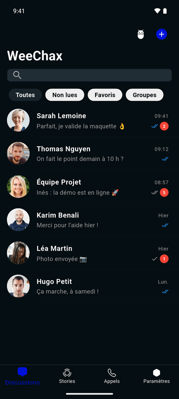
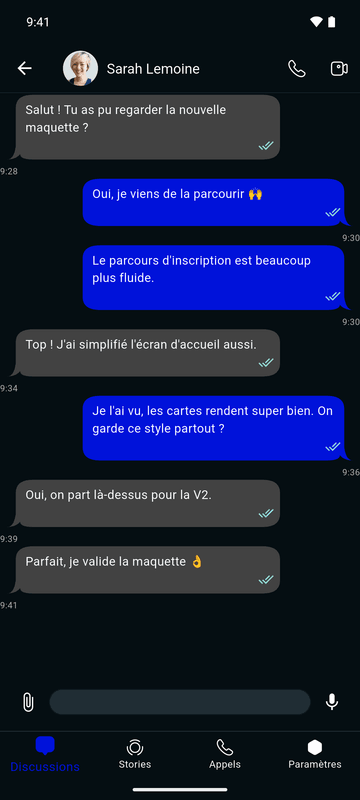

# Flutter Chat App

<p align="center"></p>


A chat app built with Flutter and Firebase: sign in, find people and chat in real time.

## Screens

<p align="center"></p>

| Sign in | Discussions | Conversation |
|:---:|:---:|:---:|
|  |  |  |

## Features

- **Authentication**: sign up and sign in with Firebase Authentication; profiles stored in Cloud Firestore.
- **People**: users listed from Firestore.
- **Discussions**: conversation list with search.
- **Conversation**: chat bubbles, messages streamed from Firestore in real time.
- **Navigation**: bottom bar with discussions, people, stories, calls and settings.

## Tech stack

- Flutter, Dart, Provider
- Firebase: Authentication, Cloud Firestore
- [chat_bubbles](https://pub.dev/packages/chat_bubbles), [persistent_bottom_nav_bar](https://pub.dev/packages/persistent_bottom_nav_bar), [flutter_animate](https://pub.dev/packages/flutter_animate), [iconsax](https://pub.dev/packages/iconsax)

```
lib/
├── core/               theme
├── data/
│   ├── models/
│   ├── providers/
│   └── repositories/   auth and users (Firestore)
├── presentation/
│   ├── navigation/
│   ├── screens/        auth, discussion, peoples, stories, call, settings
│   └── widget/, ui/
├── services/firebase/
└── utils/
```

## Getting started

1. Create a Firebase project and enable Authentication (email and password) and Cloud Firestore.
2. Register the Android app and replace `android/app/google-services.json` with yours (and add `ios/Runner/GoogleService-Info.plist` for iOS).
3. Run:

```bash
flutter pub get
flutter run
```

## Roadmap

The stories, calls and settings tabs are placeholders for now.

- [ ] Store sent messages per conversation in Firestore
- [ ] Group chats
- [ ] Images and files in messages
- [ ] Stories
- [ ] Voice calls

## Author

**Dissang Kevin** · Mobile AI Engineer
[Portfolio](https://dissangkevin.work) · [GitHub](https://github.com/kteken10)
